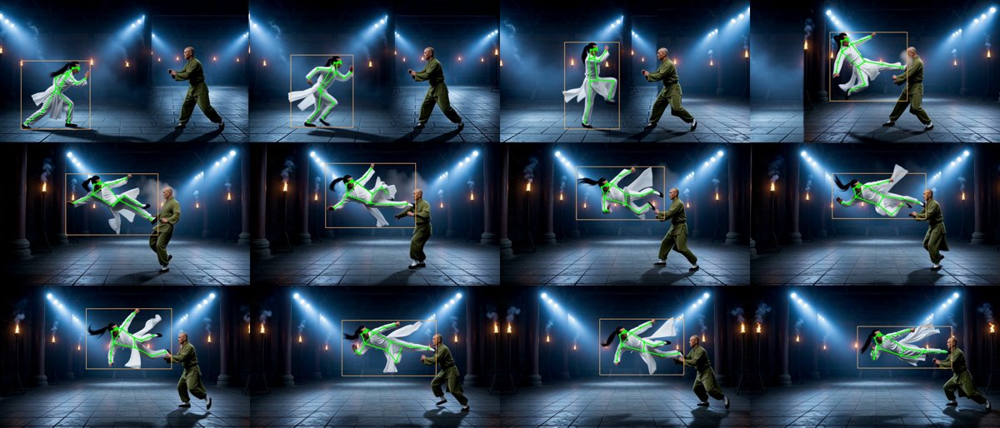
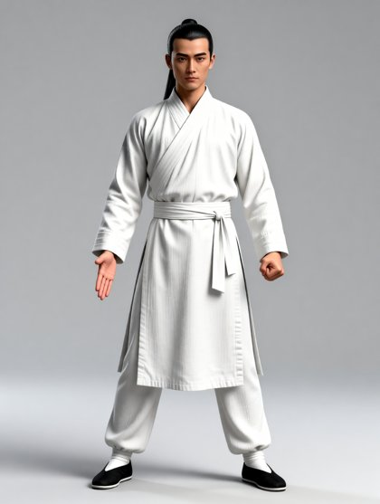
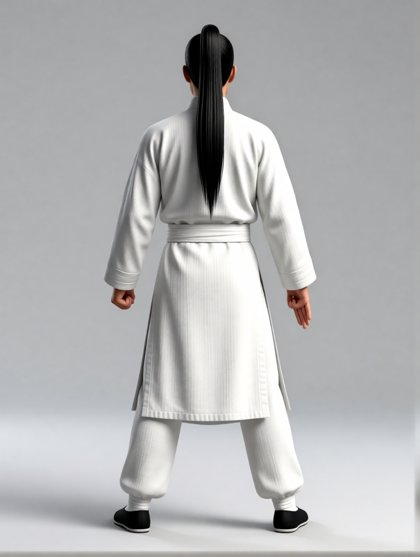
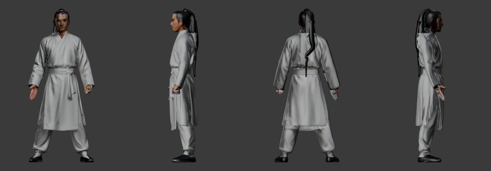
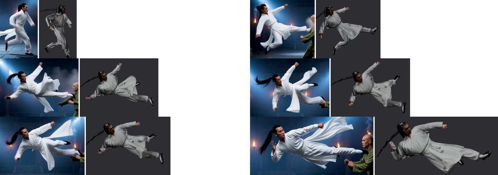
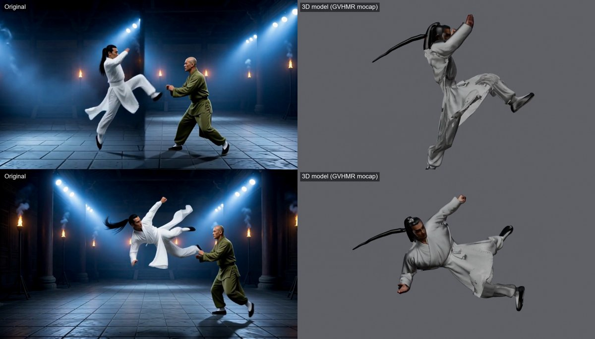

# GVHMR tutorial: copy a person's action from a video onto a generated 3D character

Take a video of a person doing something (here a kung-fu run-up and flying side kick), and get

* a **3D model of that person** generated locally in ComfyUI (Qwen-Image-Edit concept sheet -> Hunyuan3D 2.1 mesh + texture),
* **rigged and animated with the motion from the video** (GVHMR world-grounded human motion recovery, retargeted onto the rig),
* exported as **GLB + FBX**, opened in **Blender** looking through the reconstructed video camera, and rendered to **MP4** / side-by-side MP4.

| GVHMR tracking (the chosen person only) | concept sheets (front / back) | generated model |
|---|---|---|
|  |   |  |

Video vs model, rendered from the reconstructed video camera:





**Why GVHMR rather than WHAM:** GVHMR (SIGGRAPH Asia 2024) is newer and more accurate on world-grounded benchmarks,
estimates motion in a gravity-aligned frame, and works on a moving camera with its built-in feature-based visual
odometry, so it does not need the DPVO SLAM build that WHAM requires.

---

## 1. What you need

* Windows 10/11, NVIDIA GPU with 24 GB (tested on an RTX 3090), ~60 GB free disk.
* [Blender 5.2](https://www.blender.org/) (scripts use the Blender 5 API: layered actions, no Material Preview).
* [ComfyUI](https://github.com/comfyanonymous/ComfyUI) with these models / nodes:

  | file | folder in `ComfyUI/models` | used for |
  |---|---|---|
  | `qwen_image_edit_2511_fp8mixed.safetensors` | `diffusion_models` | concept sheets |
  | `Qwen-Image-Edit-2511-Lightning-4steps-V1.0-bf16.safetensors` | `loras` | 4-step sampling |
  | `qwen_2.5_vl_7b_fp8_scaled.safetensors` | `text_encoders` | |
  | `qwen_image_vae.safetensors` | `vae` | |
  | `hunyuan_3d_v2.1.safetensors` | `checkpoints` | 3D shape (native ComfyUI nodes) |
  | `birefnet.safetensors` | `background_removal` | matte for the 3D input |
  | custom node [ComfyUI-Hunyuan3DWrapper](https://github.com/kijai/ComfyUI-Hunyuan3DWrapper) | `custom_nodes` | multiview texture paint (`hunyuan3d-paint-v2-0` downloads itself) |

* [GVHMR](https://github.com/zju3dv/GVHMR) + checkpoints, and the **SMPL-X** body model
  (`SMPLX_NEUTRAL.npz`, free registration at <https://smpl-x.is.tue.mpg.de>; not redistributable, so it is not in this repo).
* `ffmpeg` on PATH, [uv](https://github.com/astral-sh/uv) for the Python environment.

## 2. Install GVHMR on Windows (no conda, no compiling)

```bash
git clone --depth 1 https://github.com/zju3dv/GVHMR C:/Software/GVHMR
cd C:/Software/GVHMR
uv venv .venv --python 3.10
uv pip install --python .venv/Scripts/python.exe torch==2.6.0 torchvision==0.21.0 --index-url https://download.pytorch.org/whl/cu124
uv pip install --python .venv/Scripts/python.exe timm==0.9.12 lightning==2.3.0 hydra-core==1.3 hydra-zen hydra_colorlog rich numpy==1.23.5 matplotlib setuptools tensorboardX opencv-python ffmpeg-python scikit-image termcolor einops imageio==2.34.1 av==13.0.0 joblib trimesh smplx wis3d ultralytics==8.2.42 lapx yacs pycolmap scipy
# prebuilt Windows pytorch3d wheel (no MSVC build needed)
uv pip install --python .venv/Scripts/python.exe "pytorch3d==0.7.8+pt2.6.0cu124" --extra-index-url https://miropsota.github.io/torch_packages_builder
uv pip install --python .venv/Scripts/python.exe pip cython
uv pip install --python .venv/Scripts/python.exe chumpy cython_bbox --no-build-isolation
uv pip install --python .venv/Scripts/python.exe -e . --no-deps
```

Checkpoints go in `inputs/checkpoints/` (official links in GVHMR's `docs/INSTALL.md`; a Hugging Face mirror is
`camenduru/GVHMR`):

```
inputs/checkpoints/gvhmr/gvhmr_siga24_release.ckpt
inputs/checkpoints/hmr2/epoch=10-step=25000.ckpt
inputs/checkpoints/vitpose/vitpose-h-multi-coco.pth
inputs/checkpoints/yolo/yolov8x.pt
inputs/checkpoints/body_models/smplx/SMPLX_NEUTRAL.npz
```

Then copy `gvhmr/run_pick_person.py` from this repo to `C:/Software/GVHMR/tools/demo/`.

Install gotchas that were hit and fixed (already reflected in the commands above):

| error | fix |
|---|---|
| `No module named 'yacs'` / `'pycolmap'` | not in GVHMR's requirements.txt: install them |
| `'VideoCodecContext' object has no attribute 'close'` | `av==13.0.0` (newer PyAV breaks imageio 2.34) |
| `Weights only load failed ... DetectionModel` | PyTorch 2.6 changed `torch.load`; run with `TORCH_FORCE_NO_WEIGHTS_ONLY_LOAD=1` (trusted official checkpoints only) |
| pytorch3d does not build on Windows | use the prebuilt wheel above |
| chumpy build fails under uv | `--no-build-isolation` after installing pip + cython |

## 3. Steps for a new video

Paths below: `T` = this repo, `G` = `C:/Software/GVHMR`, `CPY` = ComfyUI's python (`C:/ComfyUI/venv/Scripts/python.exe`),
`GPY` = GVHMR's python (`$G/.venv/Scripts/python.exe`), `BL` = `blender.exe`. Run the `pipeline/` scripts from
`$T/pipeline` (they write `concepts/`, `models/`, `build/` there). Start ComfyUI first.

### 3.1 Motion capture (GVHMR) on the person you want

```bash
cd $G
TORCH_FORCE_NO_WEIGHTS_ONLY_LOAD=1 $GPY tools/demo/run_pick_person.py --video D:/clips/myclip.mp4 --out outputs/myclip --pick white
```

`--pick` chooses the person in a multi-person video: `white` / `black` clothing, `hue --hue 120` (coloured clothing),
`largest`, or `point --point x,y` (the person under that pixel in frame 1). Add `--static_cam` for a locked-off camera.
**Check `outputs/myclip/overlay_2d.mp4`**: the box and skeleton must stay on your person in every frame.
Output: `outputs/myclip/gvhmr_smplx.npz` (world + camera-frame SMPL-X parameters, 2D keypoints, boxes, intrinsics, fps).

### 3.2 Reference crops and hand check

```bash
cd $T/pipeline
$GPY crop_refs.py D:/clips/myclip.mp4 $G/outputs/myclip/gvhmr_smplx.npz refs --hands
```

Look at `refs/refs_sheet.png`, choose 2 frames with the clearest costume / face (a calm pose + an action view), and
re-run with those frame numbers (`... refs 30 95`). Look at `refs/hands_sheet.png` (top row = the person's LEFT hand,
bottom row = RIGHT): if a hand stays a fist or an open palm through the clip, write that in the prompt. The model
is generated with those hand shapes (more robust than finger bones on a generated mesh).

### 3.3 Concept sheet (Qwen-Image-Edit)

Copy `prompts/TEMPLATE_front.txt` to `prompts/myclip_front.txt` and describe the person (see section 4), then:

```bash
$CPY make_concept.py front myclip ../prompts/myclip_front.txt refs/ref_f0030.png refs/ref_f0095.png --seed 1912
$CPY make_concept.py front myclip ../prompts/myclip_front.txt refs/ref_f0030.png refs/ref_f0095.png --seed 2610
$CPY make_concept.py back  myclip concepts/myclip_concept_s1912_1.png --extra "the long black ponytail hanging down the middle of his back"
```

Each call writes 2 images (~1 min). Pick the one with correct hands, a clean face and a faithful costume. Check
that the back view keeps the hands on the right sides.

### 3.4 3D model (Hunyuan3D 2.1 + texture paint + concept projection), ~15 min

```bash
$CPY make_3d.py myclip concepts/myclip_concept_s1912_1.png --back concepts/myclip_back_s77_0.png
```

-> `models/myclip_texfp.glb`. Optional texture clean-up of surfaces no concept view saw (inner robe panels, hair
painted onto the back of the robe); tuned for light clothing, repaints only dark grey texels in the robe zones:

```bash
$BL -b -P blender/fix_texture.py -- models/myclip_texfp.glb models/myclip_texfix.glb
```

### 3.5 Ponytail direction from the video (only for a long ponytail)

```bash
$GPY hair_dir.py D:/clips/myclip.mp4 $G/outputs/myclip/gvhmr_smplx.npz models/myclip_
```

Check `models/myclip_hairdet.png` (red = detected hair, green = direction).

### 3.6 Rig + retarget + export

```bash
$BL -b -P blender/build_mocap.py -- myclip models/myclip_texfix.glb 1.8 60000 build/myclip \
    $G/outputs/myclip/gvhmr_smplx.npz $G/inputs/checkpoints/body_models/smplx/SMPLX_NEUTRAL.npz \
    D:/clips/myclip.mp4 models/myclip_hair_dir2d.npy
```

Arguments: name, textured GLB, height in metres, triangle budget, output folder, GVHMR npz, SMPL-X model,
source video (for the camera background), hair directions (optional). Add `--no-ponytail` for short hair.
Output in `build/myclip/`: `myclip.glb`, `myclip.fbx` (textures embedded, one take), `myclip_anim.blend`
(animation + reconstructed video camera), `textures/`, `previews/`.

### 3.7 Check against the video

```bash
$BL -b build/myclip/myclip_anim.blend -P blender/render_check.py -- chk 20,66,105,130
$GPY compare.py chk D:/clips/myclip.mp4 $G/outputs/myclip/gvhmr_smplx.npz chk
```

`chk_zoom.png` = video crop | model rendered from the reconstructed camera, per frame; `chk_rest.png` = turnaround.
To iterate on the motion without rebuilding the model: `blender/retarget_only.py`; on the ponytail only:
`blender/resim_ponytail.py -- guide=models/myclip_hair_dir2d.npy`.

### 3.8 Show in Blender, render MP4, side-by-side

```bash
$BL build/myclip/myclip_anim.blend --python blender/display.py -- D:/clips/myclip.mp4   # plays over the video
$BL -b build/myclip/myclip_anim.blend -P blender/render_mp4.py -- build/myclip/myclip_model.mp4 --zoom 1.6
$CPY side_by_side.py D:/clips/myclip.mp4 build/myclip/myclip_model.mp4 build/myclip/myclip_side_by_side.mp4
```

`render_mp4.py` renders only the character on grey from a camera that follows the video camera with a longer lens
(`--zoom`) and keeps aiming at the `--target` bone; `--video-cam` renders the exact video framing instead.
In the interactive Blender window, untick the camera's *Background Images* to see the character alone.

## 4. Prompts and tips

The full prompt used for the example is `prompts/huangfeihong_front.txt`; `make_concept.py` appends the A-pose /
lighting / background part (`A_POSE`) automatically.

* **Describe every garment, material and colour**, top to bottom. "plain matte ... no embroidery, no buttons, no
  shine" keeps Qwen from inventing trim that bakes into a muddy texture.
* **Hair:** if the video shows hair combed back, say so explicitly ("no loose strands, forehead, temples, cheeks and
  ears completely clear of hair"). Face-framing strands in the concept turn into thin sheets of geometry hovering
  beside the cheeks; that cannot be fixed in the texture, only by regenerating the concept.
* **Hands:** check `hands_sheet.png` and state each hand ("his LEFT hand (on the right side of the image) is a tight
  closed fist"). Image left/right is mirrored relative to the character's left/right; spell out both.
* Generate 2-3 seeds and pick by eye; the pick matters more than anything downstream.
* Back view: pass `--extra` with what must be visible from behind (ponytail, sash knot, cape).

## 5. How it works

* **Person selection.** GVHMR's demo keeps the longest YOLO track, which can be the wrong person.
  `run_pick_person.py` scores every detection per frame (clothing colour / size / clicked point) with a continuity
  term, interpolates gaps and smooths the boxes, then runs ViTPose, HMR2 features, visual odometry and GVHMR.
* **Retarget** (`blender/mocap.py`). SMPL-X forward kinematics gives each joint's global rotation. For every rig
  bone, a rest alignment `A` takes the rig's rest bone direction onto the SMPL rest bone direction; the posed world
  rotation is `C · R_smpl · Cᵀ · A` (`C` = SMPL Y-up to Blender Z-up). The rig bone then points exactly along the
  posed SMPL bone and inherits its twist, whatever the rig's rest pose (A-pose here, T-pose for SMPL).
* **Root height.** GVHMR's world-frame root is pulled towards the ground by its motion prior (this flying kick came
  out ~0.5 m too low). The camera-frame result keeps the true image height, so the floor plane is fitted through
  the lowest foot joint of the first (ground-contact) frames in camera space, and the pelvis height above that plane
  replaces the world-frame height. Horizontal travel and all rotations stay from the world-frame result. If your
  clip does not start with the feet on the ground, change `contact_frames` in `mocap.load`.
* **Video camera.** Per frame, `world root orientation x camera-frame root orientationᵀ` gives the camera rotation;
  the position is anchored on the pelvis; focal length from GVHMR's intrinsics. The Blender camera then reproduces
  the original framing, with the source video as its background image.
* **Rig.** `blender/rigkit.py` finds joints on the A-pose mesh from its silhouette, builds Root/Hips/Spine/Chest/
  Neck/Head + arms + legs, heat-weights the skin (voxel-remesh proxy when the heat solver fails) and diffuses leg
  weights over long robes so they stretch instead of tearing.
* **Ponytail** (`blender/ponytail.py`). Hunyuan3D fuses a ponytail onto the back as one surface, so it is cut off
  below the nape, the hole is closed, and a tapered hair tube on a 6-bone chain is built from the hair tie. With
  `hair_dir2d.npy` the chain is **video-guided**: the hair's direction in each frame (black pixels connected to a
  ring around the head, from the 2D keypoints) is lifted into 3D through the reconstructed camera, with
  follow-through lag along the chain. Without it a verlet simulation (gravity, drag, airflow, head/torso collision)
  is used.

## 6. Troubleshooting

| symptom | cause / fix |
|---|---|
| wrong person tracked | other `--pick`, or `--pick point --point x,y`; delete `outputs/<clip>/preprocess/bbx.pt` before re-running |
| character floats or sinks | the first frames are used as ground contact (`contact_frames` in `mocap.load`) |
| long spike from the body to the origin in renders | a vertex with zero skin weight; `ponytail.replace` normalises the weights it touches, check any custom weighting |
| texture shows the normal map in Workbench | the active image node is the normal map; `build_mocap.py` re-activates the albedo node |
| `Action has no attribute fcurves` | Blender 5 layered actions: use `bpy_extras.anim_utils.action_get_channelbag_for_slot` |
| `enum "MATERIAL" not found` | Blender 5.2 viewport has no Material Preview; use SOLID + TEXTURE or RENDERED |
| extra camera take in the FBX | every action is baked onto the armature; `build_mocap.py` deletes all but the mocap action before FBX export |
| video background missing after moving the .blend | relative clip path broke: `display.py -- <video.mp4>` re-points it |
| `auto weights: N/N verts unweighted` | expected on Hunyuan meshes; the voxel-proxy fallback fills them (log says `proxy ... 0 verts still unweighted`) |

## 7. Limitations

* Robe panels / skirts follow the legs (diffused weights) but do not flap like cloth; that needs separate panel
  geometry + cloth simulation or bone chains (not included yet).
* Hand shape is baked into the mesh (no finger bones), so it suits clips where each hand keeps one shape.
* Wrist rotation is the least reliable part of GVHMR's output.
* `fix_texture.py` and `ponytail.py` are tuned for light clothing and black hair; adjust their thresholds for
  other characters.

## 8. Files

```
gvhmr/run_pick_person.py         GVHMR on one chosen person -> gvhmr_smplx.npz (+ overlay video)
pipeline/comfy.py                minimal ComfyUI API client (COMFY_URL / COMFY_ROOT env vars)
pipeline/crop_refs.py            reference crops + hands sheet from the tracked boxes / keypoints
pipeline/make_concept.py         Qwen-Image-Edit concept sheet (front) and back / side views
pipeline/make_3d.py              BiRefNet matte -> Hunyuan3D 2.1 shape -> clean -> paint -> concept projection
pipeline/front_align.py          fits a concept view's matte to the mesh silhouette (used by make_3d)
pipeline/hair_dir.py             per-frame ponytail direction in the video
pipeline/compare.py              video-crop | model-render comparison sheets
pipeline/side_by_side.py         original | render MP4 with labels
pipeline/blender/build_mocap.py  normalise, rig, skin, normal bake, ponytail, retarget, GLB/FBX/.blend export
pipeline/blender/mocap.py        SMPL-X FK, retarget, root-height fix, video camera reconstruction
pipeline/blender/rigkit.py       joint detection + armature for A-pose meshes
pipeline/blender/ponytail.py     ponytail replacement, video-guided / simulated hair chain
pipeline/blender/fix_texture.py  repaint dark texels on surfaces no concept view saw
pipeline/blender/clean_hi.py     removes decode floaters / sheets from the raw Hunyuan sculpt (used by make_3d)
pipeline/blender/project_front.py  bakes the full-res concept views over the multiview paint (used by make_3d)
pipeline/blender/retarget_only.py  re-bake the motion on an existing build (fast iteration)
pipeline/blender/resim_ponytail.py re-run only the ponytail
pipeline/blender/render_check.py   renders from the video camera + rest turnaround
pipeline/blender/render_mp4.py     MP4 of the character (follow camera) or the video framing
pipeline/blender/display.py        interactive playback through the video camera with the video behind
prompts/                         example + template concept prompts
```

Credits: [GVHMR](https://github.com/zju3dv/GVHMR) (Shen et al., SIGGRAPH Asia 2024), SMPL-X, Hunyuan3D 2.1,
Qwen-Image-Edit, ComfyUI-Hunyuan3DWrapper. Check each project's license for your use; the SMPL-X model and the
GVHMR / HMR2 / ViTPose checkpoints are not redistributed here.
